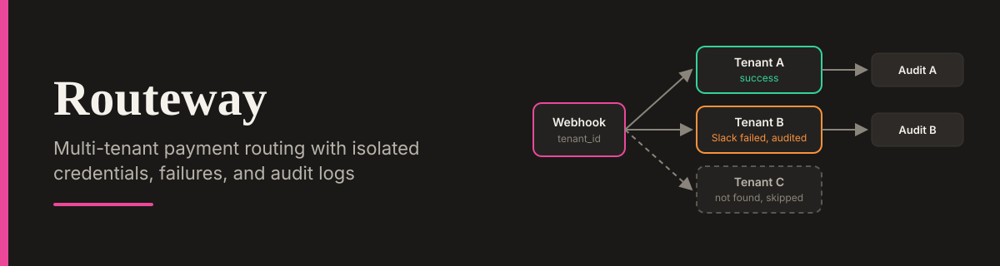

<div align="center">




</div>

# Routeway - Multi-Tenant Payment Router Dashboard

A premium B2B simulator for a multi-tenant payment routing system. This UI visualizes the logic of **Workflow 9 (Multi-Tenant Payment Notifications)** by simulating dynamic tenant lookups, Stripe payment fetches, and isolated error handling.

**Live Demo:** [routeway-multi-tenant.lovable.app](https://routeway-multi-tenant.lovable.app)

## The Problem

In a multi-tenant SaaS, a single tenant's broken integration (for example, a revoked Slack webhook) must not crash the platform for everyone else. Data must also never leak between tenants.

This dashboard visualizes a resilient routing architecture where the platform dynamically fetches a tenant's credentials, routes the payment, and handles failures gracefully without dropping the audit trail.

## n8n Workflow Reference

This UI is designed to accompany a self-hosted n8n automation. You can view the actual workflow documentation in my platform integration portfolio:

- **Repository:** [platform-integration-portfolio](https://github.com/Xhenzouu/platform-integration-portfolio)
- **Workflow Documentation:** [Workflow 9: Multi-Tenant Payment Notifications](https://github.com/Xhenzouu/platform-integration-portfolio/blob/main/docs/workflows/09-multi-tenant-payment-notifications.md)

The n8n workflow handles the following logic:

1. Receives a Stripe webhook carrying a `tenant_id`.
2. Dynamically looks up the tenant's API keys and webhook URLs from Postgres.
3. Uses the tenant's own Stripe key to fetch the payment.
4. Wraps the Slack post in a try/catch to handle per-tenant failures gracefully.
5. Writes the outcome to an isolated audit log.

This simulator mirrors that flow: the pipeline trace shows each step, and the audit table shows only the rows for the selected tenant.

## Features

- **Tenant Switcher:** Swap between Tenant A (active, valid), Tenant B (active, invalid Slack), and Tenant C (inactive).
- **Isolated Audit Logs:** Demonstrates data sandboxing by showing only the audit rows for the currently selected tenant.
- **5-Step Pipeline Simulator:** A visual trace of how the webhook is processed, step by step.
- **Graceful Failure Injection:** Step 3 (Slack) fails for Tenant B, while Step 4 (audit row) and Step 5 (respond to Stripe) still succeed.
- **Inactive Routing:** Tenant C routes to "Tenant Not Found" and skips the pipeline, leaving no audit trail.
- **Dual Themes:** Full Light and Dark mode support.

## Run Locally

1. Clone the repo:

   ```bash
   git clone https://github.com/Xhenzouu/routeway-multi-tenant.git
   cd routeway-multi-tenant
   ```

2. Install dependencies:

   ```bash
   npm install
   ```

3. Start the development server:

   ```bash
   npm run dev
   ```
